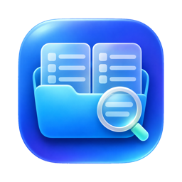

#  FileFinder

A keyboard-friendly file browser for macOS, written in SwiftUI. It browses the whole disk like Finder and adds dual panes, workspaces, tidying, developer tools and a safe cleanup page.

## Install

```sh
brew install --cask juancasanueva/tap/filefinder
```

Apple silicon and macOS 15 or later only. Or download `FileFinder-<version>.zip` from [Releases](https://github.com/juancasanueva/SWIFTUI_FileFinder/releases).

The app updates itself through Sparkle: choose **FileFinder ▸ Check for Updates…**, or turn on automatic checks in Settings ▸ General.

## Features

- **Browser**: a sidebar with Favorites, Locations, external drives and a Settings button at the bottom; a path bar that accepts typed paths (Tab completes); list and card views with Small, Medium and Large icons; a Permissions column in list view (`drwxr-xr-x`, as `ls -l` shows it); folder sizes and item counts; a status bar showing the item count, selection and free space; a function key bar at the bottom (F2 Rename, F7 Mkdir, F8 Delete, plus F5 Copy and F6 Move with two panes) whose entries are also buttons.
- **Files**: Quick Look, rename in place, New Folder, show hidden files (⇧⌘. or Settings ▸ General, shared by every window), live refresh, copy/cut/paste that works with Finder, and Undo for moves, copies, renames and Move to Trash.
- **Preview**: cards show real previews (a document's first page, a photo, a video frame). A preview pane shows the selected file, or a two-level look into the selected folder.
- **Dual pane**: two panes side by side, copy or move the selection to the other pane, drag to move (hold ⌥ to copy), a transfer queue with progress and Cancel, and a choice of keep both, replace or skip on name conflicts. Both panes are restored after relaunch.
- **Workspaces**: named pages that gather folders and files from anywhere, including cloud and external drives. Nothing is copied or moved.
- **Tidy**: moves loose files into folders by kind (Videos, Images, PDFs, Documents, Installers, Other). You see the plan before anything moves, and Undo puts it all back. You can also group a folder by kind or date added without moving anything on disk.
- **Developer tools**: a built-in Ghostty terminal panel (the Terminal toolbar button opens a shell in the current folder, and reads your Ghostty config); the git branch and uncommitted changes in the path bar (read-only, it never fetches or changes anything); open the current folder in your terminal or editor; type commands such as `code .`, `cursor .`, `xed .` or `zed` in the path bar.
- **Smart Clean**: shows how full the Mac is, then nine suggestions in two groups. *Safe to clear* starts ticked: developer caches, duplicates (the copy you opened last is kept), installers for apps you already have, and Mail's copies of attachments. *Your call* starts unticked: big files, apps unused for 6 months, old screen recordings, old downloads and leftovers of deleted apps. Everything goes to the Trash first and Undo brings it back. Empty Trash always asks.

## Keyboard shortcuts

| Shortcut | Action |
| --- | --- |
| ⌘L | Type a path |
| Space | Quick Look |
| Return | Open the selected folder, or rename the selected file |
| Backspace | Go up to the enclosing folder |
| F2 | Rename |
| Escape | Cancel a rename or the typed path |
| ⇧⌘N or F7 | New Folder |
| F8 | Move to Trash (like ⌘⌫) |
| ⇧⌘. | Show or hide hidden files |
| ⌘+ / ⌘− | Bigger or smaller icons |
| ⇧⌘P | Preview pane |
| ⌘Z | Undo |
| ⌘D | Split into two panes, or back to one |
| ⌥⌘← / ⌥⌘→ | Focus the left / right pane |
| ⌘U | Swap panes |
| F5 / F6 | Copy / move the selection to the other pane |
| ⌥⌘N | New workspace |
| ⌃1–⌃9 | Open a workspace |
| ⌥⌘T | Tidy this folder |
| ⌥⇧⌘T | Open the folder in Terminal |
| ⌥⇧⌘E | Open the folder in your editor |

These are the defaults. Menu shortcuts can be changed in Settings ▸ Keyboard (click a shortcut, then type the new one; Escape cancels) or in `~/.config/filefinder/keybindings.json` (`$XDG_CONFIG_HOME/filefinder/keybindings.json` when that is set). The file is created with every action on first launch, and edits to it apply while the app runs:

```json
{
  "goBack": "cmd+[",
  "newFolder": "cmd+shift+n",
  "openInTerminal": "cmd+alt+shift+t",
  "smartClean": "",
  "splitView": "cmd+d"
}
```

A shortcut is modifiers (`cmd`, `ctrl`, `alt`, `shift`) and one key, joined with `+`: a character, `plus`, `tab`, `delete`, `return`, `escape`, `space`, `up`, `down`, `left`, `right` or `f1`–`f12`. An empty value means no shortcut. An action missing from the file, or with a value that can't be read, keeps its default. At launch, a file that isn't valid JSON is set aside as `keybindings.json.damaged-<time>` and the defaults are written again; saved with a mistake while the app runs, it is left alone and the shortcuts in use stay until it reads again. In Settings, a key needs ⌘, ⌃ or ⌥ (F1–F12 and Tab can stand alone), so a shortcut never takes a key needed for typing. ⌃1–⌃9, F7 and F8 (New Folder and Move to Trash in the function key bar) and the keys inside dialogs can't be changed; giving F7 or F8 to a menu action in the file takes it from the bar.

## Requirements

- macOS 15 or later to run it
- Xcode 27.2 to build it (the release uses the macOS 27.2 SDK)

The app runs without the App Sandbox so it can browse the whole disk. Full Disk Access is optional and only needed for protected folders.

## Build and run

Open `FileFinder.xcodeproj` in Xcode, choose the **FileFinder** scheme and press ⌘R.

From the command line:

```sh
xcodebuild build -scheme FileFinder -destination 'platform=macOS'
```

## Tests

Unit tests use Swift Testing:

```sh
xcodebuild test -scheme FileFinder -destination 'platform=macOS' -only-testing:FileFinderTests
```

Some tests move small files to your real Trash.

## Releasing

A pushed `v*` tag builds, signs, notarizes and publishes a release and its update feed. See [RELEASING.md](RELEASING.md).

## Project layout

```
FileFinder/            App sources
  Browser/             Browser model and commands
    FileSystem/        Listing, watching, copying and file actions with Undo
    Keybindings/       Menu shortcuts and keybindings.json
    Model/             File items, grouping, refresh pacing
    Navigation/        Typed paths, sidebar locations, status text
    SmartClean/        Storage overview and cleanup scanners
    Tidy/              File kinds used by Tidy and grouping
    Developer/         Git status, terminals, editors, path bar commands
    Views/             SwiftUI views
    Workspaces/        Workspace storage
  Updates/             Check for Updates (Sparkle)
  Resources/           Update keys merged into Info.plist
FileFinderTests/       Unit tests
FileFinderUITests/     UI tests
scripts/               Release build and appcast scripts
.github/workflows/     The release pipeline
```

## License

MIT. See [LICENSE](LICENSE).
